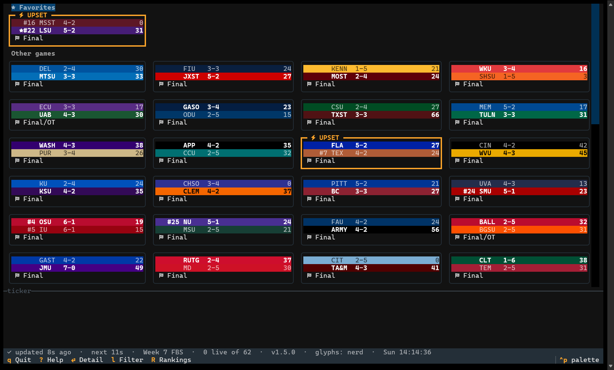
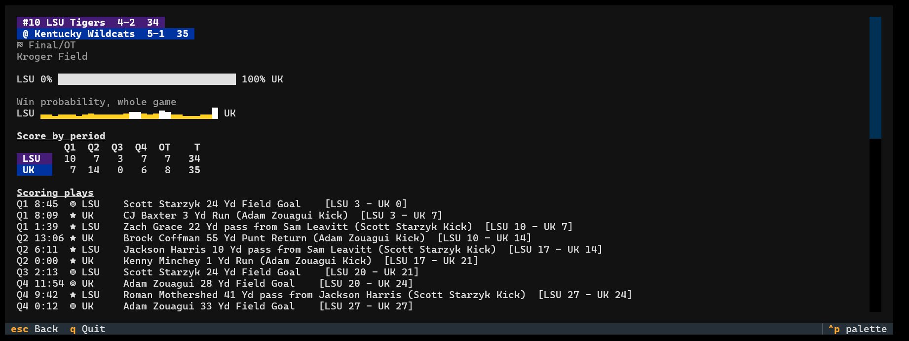
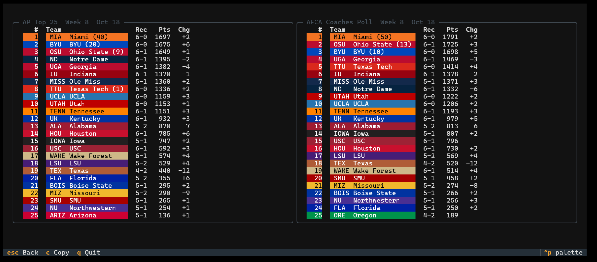
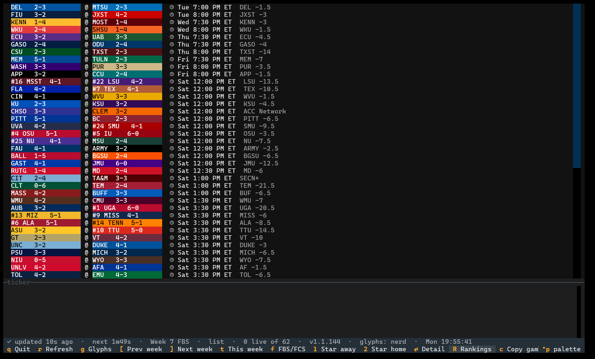
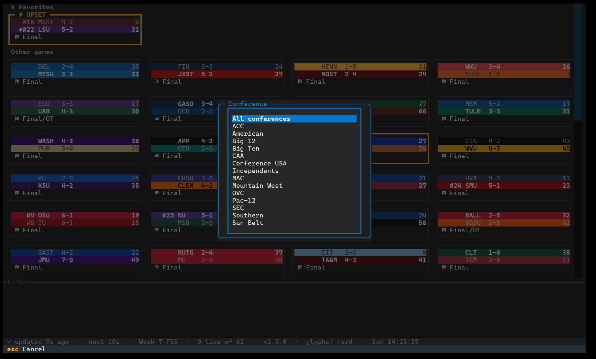
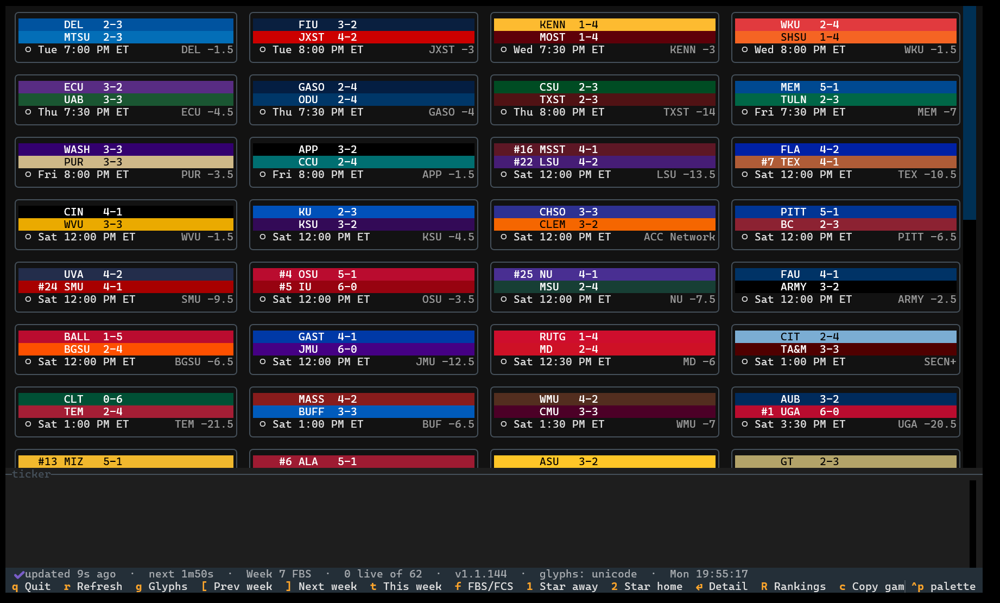

# cfbtui

[](https://github.com/WPTK/cfbtui/actions/workflows/ci.yml)
[](https://github.com/WPTK/cfbtui/releases/latest)

[](LICENSE)

A college football scoreboard for your terminal. Live scores, rankings and scoring plays for every FBS and FCS game, in one window.



- [Features](#features)
- [Install](#install)
- [Usage](#usage)
- [Keys](#keys)
- [Command-line options](#command-line-options)
- [Configuration](#configuration)
- [Troubleshooting](#troubleshooting)
- [Privacy and data source](#privacy-and-data-source)
- [Development](#development)
- [License](#license)

## Features

- Every FBS and FCS game for the week, live ones first, then upcoming, then finished.
- Updates on its own: every 20 seconds while you're at the computer, every 2 minutes once you've stepped away.
- Live cards show the clock, down and distance, and who has the ball. A card flashes when someone scores.
- Upset alerts: when a ranked team is losing, or lost, to a worse-ranked or unranked team, its card gets a yellow border and an UPSET label.
- A ticker of scores, kickoffs and upsets as they happen.
- Game detail with every scoring play and win probability.
- AP and Coaches polls, switching to the CFP ranking once the committee releases it.
- Starred favorites pinned at the top, saved between runs.
- Filters for Top 25, live games and favorites, plus a conference picker.
- Cards or a one-line-per-game list.
- Any week of the season, plus Bowls and the Playoff.
- Copy a game, or the whole board, for pasting into Discord.
- A notice when a newer version is out.

## Install

cfbtui is one file with nothing else to install. Pick yours from the
[latest release](https://github.com/WPTK/cfbtui/releases/latest):

| System | File |
|---|---|
| Windows | `cfbtui-windows-x86_64.exe` |
| macOS, Apple silicon | `cfbtui-macos-arm64` |
| macOS, Intel | `cfbtui-macos-x86_64` |
| Linux, x86_64 | `cfbtui-linux-x86_64` |
| Linux, arm64 (Raspberry Pi OS 64-bit, Asahi) | `cfbtui-linux-arm64` |

You need a terminal that shows colors and Unicode. Windows Terminal, iTerm2, Terminal.app and any modern Linux
terminal do. The old Windows Command Prompt window does not.

**Windows.** Open Windows Terminal, go to the folder you saved it in, and run `.\cfbtui-windows-x86_64.exe`.
Rename it to `cfbtui.exe` if you would rather type less. The exe is not code-signed yet, so Windows may warn
about an unrecognized app the first time. Choose **More info**, then **Run anyway**.

**macOS.** The binary is not notarized, so macOS quarantines it when you download it. In Terminal:

```
chmod +x cfbtui-macos-arm64
xattr -d com.apple.quarantine cfbtui-macos-arm64
./cfbtui-macos-arm64
```

**Linux.** Works on any distribution from 2020 on (glibc 2.31 or newer: Ubuntu 20.04, Debian 11, Fedora 32,
RHEL 9 and later). Copying for Discord uses the system clipboard, so install `xclip` on X11 or `wl-clipboard`
on Wayland if `c` says there is no clipboard.

```
chmod +x cfbtui-linux-x86_64
./cfbtui-linux-x86_64
```

On macOS and Linux, move the file somewhere on your `PATH` and rename it `cfbtui` to run it from anywhere.

**With your own Python (3.13 or newer).** Every release also carries the source tarball and a wheel. Download
the `.whl` and install it with [pipx](https://pipx.pypa.io/) or [uv](https://docs.astral.sh/uv/), and you get a
`cfbtui` command on any system:

```
pipx install ./cfbtui-1.5.0-py3-none-any.whl
```

**Checking a download.** Every release carries a `SHA256SUMS` file. Save it next to the file you downloaded and run
`sha256sum -c --ignore-missing SHA256SUMS` on Linux, `shasum -a 256 -c --ignore-missing SHA256SUMS` on macOS, or
`(Get-FileHash .\cfbtui-windows-x86_64.exe).Hash` in PowerShell and compare it with the line in the file.

The built-in updater checks its download against the `SHA256SUMS` of the same release. That guards against a
corrupted download, not against a compromised GitHub account. The binaries, tarball and wheel also carry GitHub
build attestations, which you can check with the GitHub CLI:

```
gh attestation verify cfbtui-linux-x86_64 -R WPTK/cfbtui
gh release verify vX.Y.Z -R WPTK/cfbtui   # once the repository has immutable releases turned on
```

## Usage

Run `cfbtui` and the current week's games appear. Use the arrow keys to move between cards and press `Enter`
to open one. The rest of this page writes `cfbtui` for whichever file you downloaded.



**Favorites.** Press `1` or `2` to star the away or home team of the selected game. Starred teams' games move
to a Favorites section at the top.

**Rankings.** `R` shows the AP and Coaches polls. Once the College Football Playoff committee releases its
first ranking, you see only the CFP ranking through the end of the season. The FCS board shows the FCS
Coaches poll.



**Views.** `v` switches between cards and a one-line-per-game list. `l` cycles the filter and `o` opens the
conference picker.





**Discord.** `c` copies one game as a line of text with the winner in bold. `C` copies the board as a code
block. Discord caps messages at 2,000 characters, so on a big Saturday `C` copies one part at a time; press
it again for the next part.

## Keys

| Key | What it does |
|---|---|
| arrow keys | Move between games |
| `Enter` | Open the game: every scoring play and win probability |
| `R` | Rankings. In there, `c` copies the polls for Discord, one per press |
| `[` `]` | Previous / next week. After week 15 come **Bowls** and the **Playoff** |
| `t` | Back to this week |
| `f` | Switch between FBS and FCS |
| `l` | Filter: all games, Top 25, live only, favorites |
| `o` | Pick a conference |
| `v` | Switch between cards and a one-line-per-game list |
| `S` | Settings: alerts, auto-update, icon style and default layout, saved as you change them |
| `1` `2` | Star the away / home team of the selected game |
| `c` | Copy the selected game for Discord |
| `C` | Copy every game on screen for Discord |
| `r` | Refresh now |
| `g` | Change the icon style |
| `Esc` | Close a screen |
| `q` | Quit |

## Command-line options

These apply to that run only.

```
cfbtui --week 9              start on week 9 (also: --week bowls, --week playoff)
cfbtui --group fcs           start on the FCS board
cfbtui --glyphs unicode      icon style: ascii, unicode, emoji, nerd
cfbtui --layout list         one line per game
cfbtui --config PATH         use this settings file instead of the default
cfbtui --no-update-check     don't look for a newer version
cfbtui --no-config           ignore and never touch the settings file
cfbtui --version
```

## Configuration

cfbtui creates a settings file the first time you star a team, and you can edit it in any text editor. Anything
you leave out uses the default, and a bad value is ignored with a warning.

| System | Settings file |
|---|---|
| Windows | `%LOCALAPPDATA%\cfbtui\config.toml` |
| macOS | `~/Library/Application Support/cfbtui/config.toml` |
| Linux | `~/.config/cfbtui/config.toml` (or under `$XDG_CONFIG_HOME`) |

```toml
[poll]
live = 20          # seconds between updates while you are at the computer
idle = 120         # seconds between updates once you have walked away
away_after = 300   # seconds without keyboard or mouse input before you count as away

[view]
glyph_set = "nerd" # ascii, unicode, emoji, nerd
layout = "grid"    # grid or list
week = 7           # 1-15, 16 for Bowls, 17 for the Playoff; leave out for the current week
group = "fbs"      # fbs or fcs

[favorites]
team_ids = ["251"]
abbreviations = ["TEX"]   # you can also list teams by abbreviation

[alerts]
enabled = true     # pulse a card on a score or a lead change

[updates]
check = true       # set to false to never check for a newer version
auto = true        # download new versions on their own (standalone binaries only)
```

### Updates

With `check = true` cfbtui looks for a newer release at startup. What happens next depends on how you installed it:

- **Standalone binary, `auto = true`:** a new minor or patch version is downloaded in the background, checked
  against the release's `SHA256SUMS` (this catches corruption, not a compromised GitHub account) and test-run. The status bar then shows `update X.Y.Z ready` and a message
  says it takes over when you quit. Nothing changes while you are using cfbtui; the new file replaces the old one
  as you quit, and the next start runs it. To switch right away, open Settings (`S`) and choose **Restart now**.
  The update is installed only if cfbtui exits normally and auto-update is still on when you quit (turn it off
  in Settings and the downloaded file is deleted instead); after a crash or error exit it is discarded.
- **A new major version, `auto = false`, `--no-config`, or no download for your platform:**
  you just get a message with a link to the release.
- **pip, pipx and uv installs:** you get a message with the upgrade command (`pipx upgrade cfbtui`,
  `uv tool upgrade cfbtui` or `python -m pip install -U cfbtui`). cfbtui never changes those installs itself.
- `--no-update-check` (or `check = false`) turns off both the check and the download.

If an update fails, your installed copy is left as it was and you get one warning. The previous version is kept
beside the new one as `cfbtui.old` (`cfbtui.exe.old` on Windows) until the new version has started once. If cfbtui
ever fails to start after an update, rename that `.old` file back to the program's name.

## Troubleshooting

**Icons show as empty boxes.** The default `nerd` icon style needs a [Nerd Font](https://www.nerdfonts.com/)
set as your terminal's font. Press `g` to cycle to another style, or start with `--glyphs unicode`.



**"Could not reach ESPN."** cfbtui keeps retrying and backs off between attempts. Check your connection; if
the rest of the internet works, ESPN's service may be down.

**No games listed.** The week may have no games, or the filter and conference may be hiding them. The
bottom bar shows the active filter. Press `l` until it says all games, and `t` to return to this week.

## Privacy and data source

Scores come from ESPN's public scoreboard service, which is unofficial and undocumented and can change or
disappear without warning. cfbtui is an independent project, not affiliated with ESPN or the NCAA.

At startup it also asks GitHub whether a newer release exists. That is the only other request it makes, and
it sends no personal information. Turn it off with `--no-update-check` or `check = false` in the settings
file.

## Development

Building from source, running the tests and cutting a release: [docs/development.md](docs/development.md).

## License

MIT. See [LICENSE](LICENSE).
