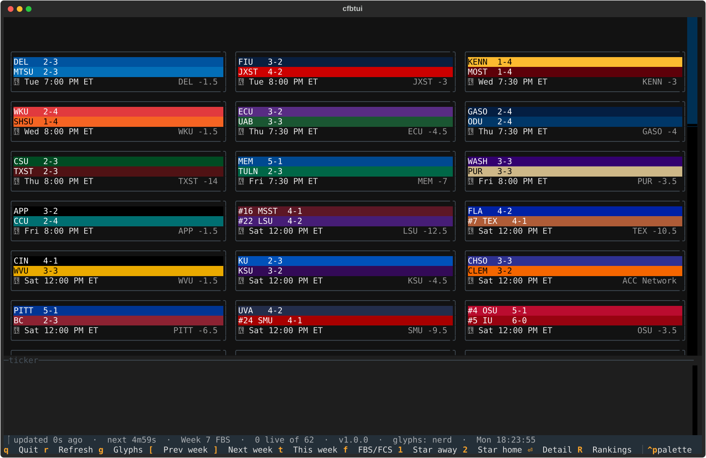
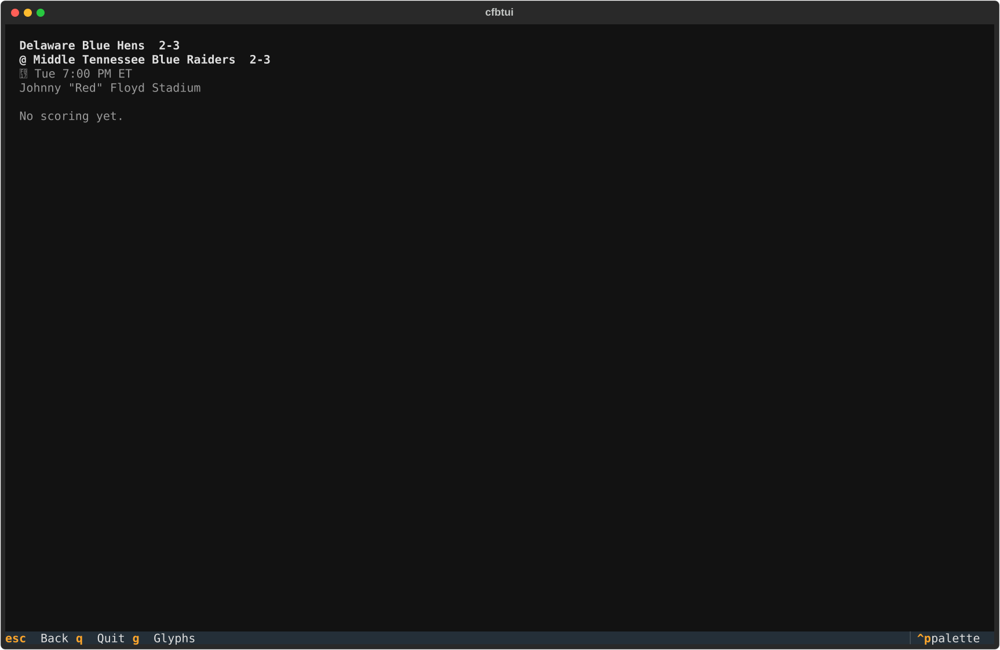
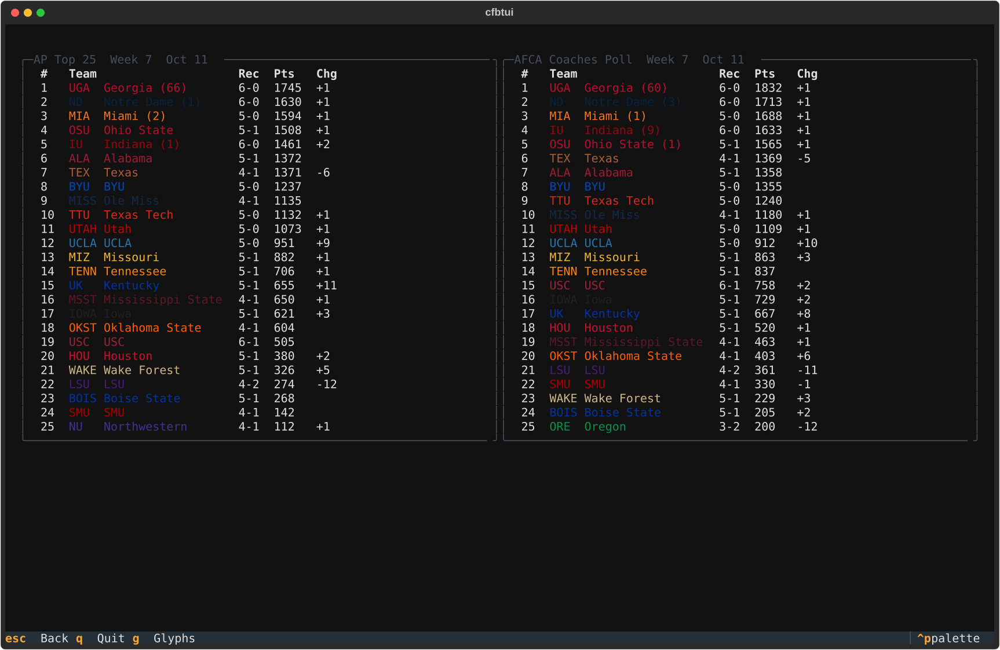
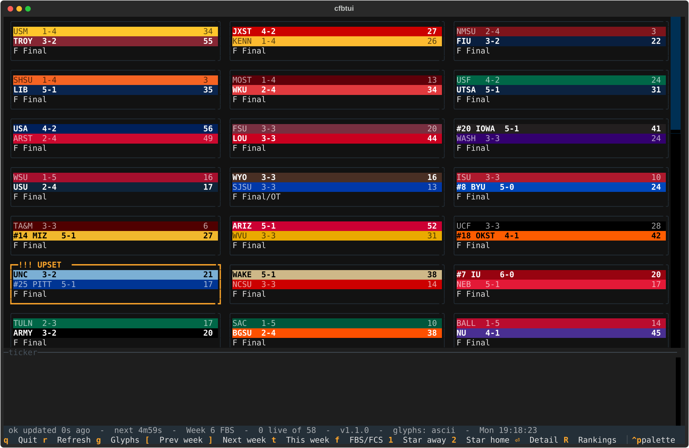

# cfbtui

A colorful college football scoreboard for the terminal. Windows Terminal first.

Game cards painted in real team colors, live clock and down-and-distance, AP and Coaches rankings, upset
flags, a flash on every touchdown and field goal, a live event ticker, per-game scoring plays with win
probability, and one key to copy any game to Discord.



## Install

**Download the exe.** Grab `cfbtui.exe` from the [latest release](https://github.com/WPTK/cfbtui/releases/latest)
and run it from Windows Terminal. No Python needed. Each release also carries `cfbtui.exe.sha256`; compare it with

```powershell
(Get-FileHash cfbtui.exe -Algorithm SHA256).Hash
```

The exe is not code-signed, so Windows SmartScreen may ask you to confirm the first run.

**Or run from source** (Python 3.13):

```powershell
python -m venv .venv
.venv\Scripts\python -m pip install -e .[dev]
.venv\Scripts\python -m cfbtui
```

Tests: `.venv\Scripts\python -m pytest`. Build the exe yourself: `scripts\build_exe.ps1`.

## Keys

| Key | Action |
|---|---|
| arrows | Move between cards |
| `Enter` | Game detail: scoring plays and win probability |
| `R` | Rankings: AP and AFCA Coaches (the FCS poll on the FCS board) |
| `[` `]` | Previous week, next week |
| `t` | Back to this week |
| `f` | Toggle FBS / FCS |
| `1` `2` | Star the away / home team of the focused game |
| `c` | Copy the focused game as Discord Markdown |
| `C` | Copy every visible game; a board over Discord's 2000 characters is copied one part per press |
| `r` | Refresh now |
| `g` | Cycle the glyph set |
| `Esc` | Close the detail or rankings screen |
| `q` | Quit |





## Command line

```
cfbtui [--week N] [--group fbs|fcs] [--glyphs NAME] [--config PATH] [--no-config] [--version]
```

Flags apply to that run only and are never written to the config file.

## Config

The file is created only when you star a favorite. It lives at `%LOCALAPPDATA%\cfbtui\config.toml`
(run `cfbtui --help` to see the exact path). Every key is optional; a bad value is dropped with a warning
and the default stands.

```toml
[poll]
live = 20          # seconds between polls while a game is live
idle = 300         # seconds between polls otherwise
backoff_max = 120  # longest wait after errors

[view]
glyph_set = "nerd" # ascii, unicode, emoji, nerd
week = 7           # omit for ESPN's current week
group = "fbs"      # fbs or fcs

[favorites]
team_ids = ["251"]
abbreviations = ["TEX"]
```

## Glyph sets

Every icon comes from one table, in four sets: `ascii`, `unicode`, `emoji` and `nerd` (the default).
`nerd` needs a [Nerd Font](https://www.nerdfonts.com/) in your terminal; without one you will see boxes, so
press `g` or start with `--glyphs unicode`. Box-drawing borders are the same in all sets. Copied Discord text
always uses the `unicode` set.




## Data

Scores come from ESPN's unofficial, undocumented site API. It needs no key, can change or vanish without
notice, and is not affiliated with this project. cfbtui is an independent hobby project and is not
affiliated with or endorsed by ESPN or the NCAA. Team names and colors belong to their owners.

Screenshots in `docs/img/` are rendered by `scripts/screenshots.py` from live ESPN data at the time they
were taken; `--fixtures` renders from saved test payloads instead.

## Versions

Versions follow FibVer: each part advances to the next Fibonacci number (0, 1, 2, 3, 5, 8, 13 ...) instead
of adding one. Every release's story is in [CHANGELOG.md](CHANGELOG.md).

## License

MIT. See [LICENSE](LICENSE).
