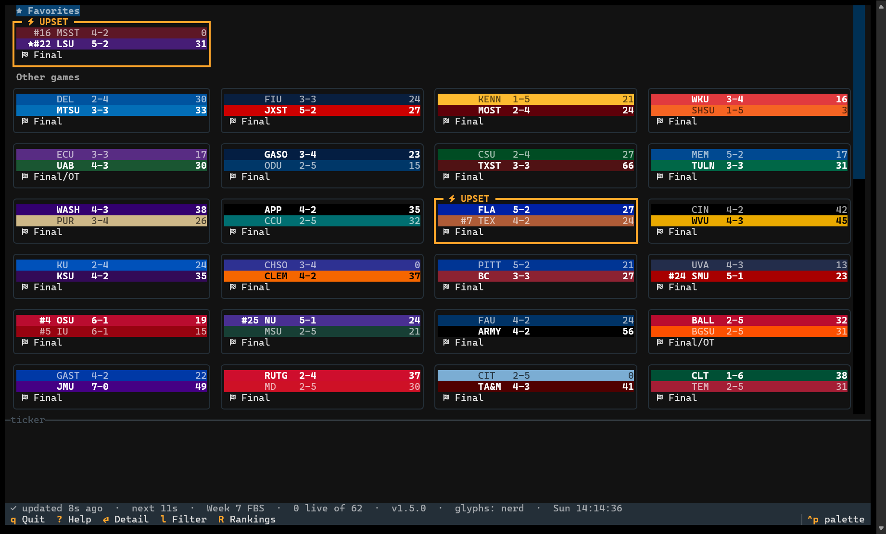
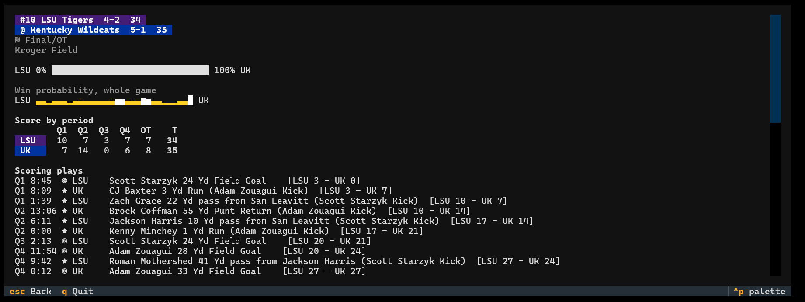
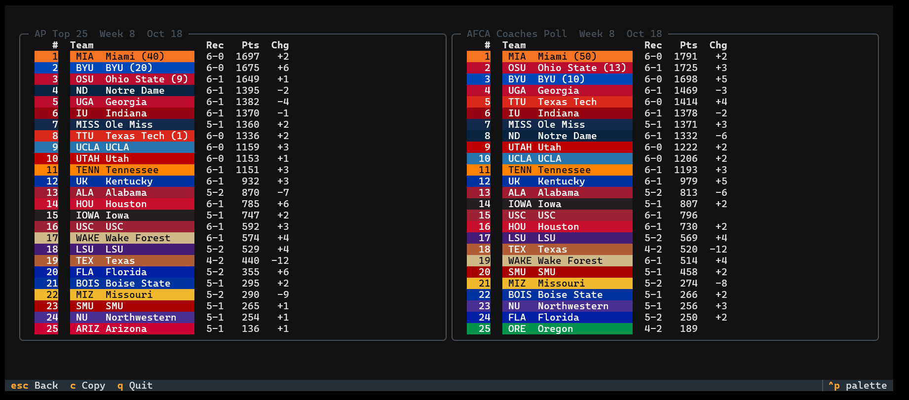

# cfbtui

[](https://github.com/WPTK/cfbtui/releases/latest)

cfbtui is a terminal scoreboard for FBS and FCS college football. It reads ESPN's unofficial public JSON endpoints (no API key) and renders live scores, rankings, scoring plays and news in a [Textual](https://textual.textualize.io/) interface.



- Games for the week, live ones first. Scores refresh every 20 seconds while you are at the computer and every 2 minutes once you step away.
- Live cards show the clock, down and distance, and who has the ball, and flash on a score.
- A card gets a yellow border and an UPSET label when a ranked team is losing, or lost, to a worse-ranked or unranked team.
- Game detail has every scoring play and win probability. AP and Coaches polls switch to the CFP ranking once the committee releases it.
- ESPN's college football news opens in the app.
- You can star favorites, filter, pick a conference, switch between cards and a list, and open any week including Bowls and the Playoff.
- You can copy a game, or the whole board, for pasting into Discord.

## Prerequisites

- A terminal with color and Unicode: Windows Terminal, iTerm2, Terminal.app or a current Linux terminal. The old Windows Command Prompt window does not qualify.
- To run the standalone binary: Windows, macOS (Apple silicon or Intel), Linux x86_64 or Linux arm64 with glibc 2.31 or newer (Ubuntu 20.04, Debian 11, Fedora 32, RHEL 9).
- To install from PyPI or run from source: Python 3.13 or newer.
- For Discord copy on Linux: `xclip` (X11) or `wl-clipboard` (Wayland).
- For the default icon style: a [Nerd Font](https://www.nerdfonts.com/) set as the terminal font. Without one, start with `--glyphs unicode`.

## Quickstart

From PyPI (recommended if you already have Python 3.13 or newer):

1. Install it with [pipx](https://pipx.pypa.io/):

   ```sh
   pipx install cfbtui
   ```

2. Run it:

   ```sh
   cfbtui
   ```

To upgrade, run `pipx upgrade cfbtui`. To remove it, run `pipx uninstall cfbtui`.

Standalone binary (no Python needed):

1. Download the file for your system from the [latest release](https://github.com/WPTK/cfbtui/releases/latest): `cfbtui-windows-x86_64.exe`, `cfbtui-macos-arm64`, `cfbtui-macos-x86_64`, `cfbtui-linux-x86_64` or `cfbtui-linux-arm64`.
2. On macOS and Linux, make it executable. On macOS, also remove the quarantine flag (the binary is not notarized):

   ```sh
   chmod +x cfbtui-macos-arm64
   xattr -d com.apple.quarantine cfbtui-macos-arm64
   ```

3. Run it. On Windows the exe is not code-signed, so if SmartScreen warns, choose More info, then Run anyway.

   ```sh
   ./cfbtui-macos-arm64
   ```

   ```powershell
   .\cfbtui-windows-x86_64.exe
   ```

From source, for the development version:

1. Clone the repository and create a virtual environment:

   ```sh
   git clone https://github.com/WPTK/cfbtui.git
   cd cfbtui
   python3 -m venv .venv
   ```

2. Install the package. On Windows use `.venv\Scripts\python`; on macOS and Linux use `.venv/bin/python`:

   ```sh
   .venv/bin/python -m pip install -e .
   ```

3. Run it:

   ```sh
   .venv/bin/python -m cfbtui
   ```

Expected result: the current week's games appear as cards within a few seconds. Press `?` for every key and `q` to quit. If you see "Could not reach ESPN", check your connection; cfbtui keeps retrying.

To verify a download, see [docs/verify.md](https://github.com/WPTK/cfbtui/blob/main/docs/verify.md).

## Configuration

Settings come from three layers. Command-line flags override the settings file for that run only. The settings file overrides the defaults. A bad value is ignored with a warning.

### Flags

| Flag | Default | Description |
|---|---|---|
| `--week N` | current week | Start on week 1-15, `16` for the Bowls or `17` for the Playoff; `bowls` and `playoff` also work. |
| `--group fbs\|fcs` | `fbs` | Start on the FBS or FCS board. |
| `--glyphs NAME` | `nerd` | Icon style: `ascii`, `unicode`, `emoji` or `nerd`. Changes icons, bars and sparklines; box-drawing borders stay the same. |
| `--layout grid\|list` | `grid` | Cards, or one line per game. |
| `--config PATH` | platform default | Read and save this settings file. |
| `--no-config` | off | Ignore the settings file and never write it. |
| `--no-update-check` | off | Skip the release check and the download. |
| `--version` | | Print the version and exit. |

### Settings file

cfbtui creates the file the first time you star a team or change a setting. Edit it in any text editor.

| System | Path |
|---|---|
| Windows | `%USERPROFILE%\AppData\Local\cfbtui\config.toml` |
| macOS | `~/Library/Application Support/cfbtui/config.toml` |
| Linux | `~/.config/cfbtui/config.toml`, or under `$XDG_CONFIG_HOME` |

On Windows the folder comes from the system's local app-data lookup, so a redirected `LOCALAPPDATA` environment variable is not used. `--config PATH` overrides the whole path.

| Key | Default | Description |
|---|---|---|
| `[poll] live` | `20` | Seconds between updates while you are at the computer. |
| `[poll] idle` | `120` | Seconds between updates once you have walked away. |
| `[poll] away_after` | `300` | Seconds without keyboard or mouse input before you count as away. |
| `[poll] backoff_max` | `120` | Longest wait in seconds between retries after failed requests. |
| `[view] glyph_set` | `"nerd"` | `ascii`, `unicode`, `emoji` or `nerd`. |
| `[view] layout` | `"grid"` | `grid` or `list`. |
| `[view] week` | current week | 1-15, 16 for Bowls, 17 for the Playoff. |
| `[view] group` | `"fbs"` | `fbs` or `fcs`. |
| `[favorites] team_ids` | `[]` | ESPN team ids, such as `["251"]`. The `1` and `2` keys fill this in. |
| `[favorites] abbreviations` | `[]` | Teams by abbreviation, such as `["TEX"]`. |
| `[alerts] enabled` | `true` | Pulse a card on Red Zone, Upset Watch, Overtime or Final. |
| `[updates] check` | `true` | Look for a newer release at startup. |
| `[updates] auto` | `true` | Download new minor and patch versions (standalone binaries only). |

Update behavior is in [docs/updating.md](https://github.com/WPTK/cfbtui/blob/main/docs/updating.md).

## Usage and controls

Arrow keys move between cards, `Enter` opens one and `?` lists every key.



| Key | Action |
|---|---|
| arrow keys | Move between games. |
| `Enter` | Open the game: every scoring play and win probability. |
| `R` | Rankings. Press `c` there to copy the polls for Discord, one poll per press. |
| `N` | News. `Enter` reads a story, `o` opens the original in your browser, `r` refreshes. |
| `[` `]` | Previous or next week. After week 15 come Bowls and the Playoff. |
| `t` | Back to this week. |
| `f` | Switch between FBS and FCS. |
| `l` | Filter: all games, Top 25, live, favorites, Upset Watch, Red Zone, Overtime, Interesting. |
| `o` | Pick a conference. |
| `v` | Switch between cards and a list. |
| `S` | Settings. Changes save as you make them. |
| `1` `2` | Star the away or home team. Starred games move to a Favorites section at the top. |
| `c` | Copy the selected game for Discord, with the winner in bold. |
| `C` | Copy the board as a code block. Discord caps messages at 2,000 characters, so a big Saturday copies one part per press. |
| `r` | Refresh now. |
| `g` | Cycle the icon style. |
| `Tab`, then `Up` or `Down` | Move through the ticker. `Enter` or a click shows that game. |
| `Esc` | Close a screen. |
| `q` | Quit. |

Once the College Football Playoff committee releases its first ranking, `R` shows only the CFP ranking for the rest of the season. The FCS board shows the FCS Coaches poll.

Each poll's header shows the week ESPN labels that poll with, which can differ from the week the scoreboard shows, for example while the next week's poll is already out.



## Troubleshooting

- Icons show as empty boxes: set a Nerd Font as the terminal font, or press `g` to cycle to another icon style. The icon style changes icons, bars and sparklines; box-drawing borders are drawn by Textual and look the same in every style.
- "Could not reach ESPN": check your connection. If the rest of the internet works, ESPN's service may be down. cfbtui retries with growing waits.
- No games listed: the week may have no games, or a filter or conference is hiding them. Press `l` until the bottom bar says all games, then `t`.
- `c` reports no clipboard on Linux: install `xclip` or `wl-clipboard`.

## Data and privacy

Scores and news come from ESPN's public, unofficial and undocumented endpoints, which can change or disappear without notice. cfbtui is an independent project and has no affiliation with ESPN or the NCAA.

The news list refreshes every 10 minutes while you are at the computer and stops once you step away (on Windows; on other systems cfbtui cannot detect this and assumes you are there). A story's text is fetched only when you open it, kept in memory for the last 20 stories and never written to disk. Stories show ESPN's name as the source, and `o` opens the original. ESPN's content falls under Disney's [terms of use](https://disneytermsofuse.com/english/), which grant a personal, noncommercial licence and restrict automated access and copying. Fetching a story only when you ask lowers that risk and does not remove it. This is not legal advice.

At startup cfbtui requests the latest release from GitHub. The request reveals your IP address and nothing else. Turn it off with `--no-update-check` or `check = false`.

## License

MIT. See [LICENSE](https://github.com/WPTK/cfbtui/blob/main/LICENSE).
