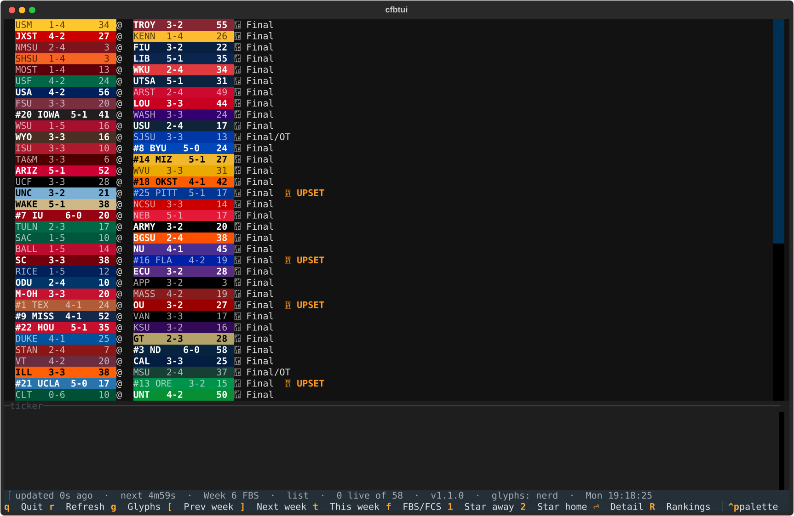
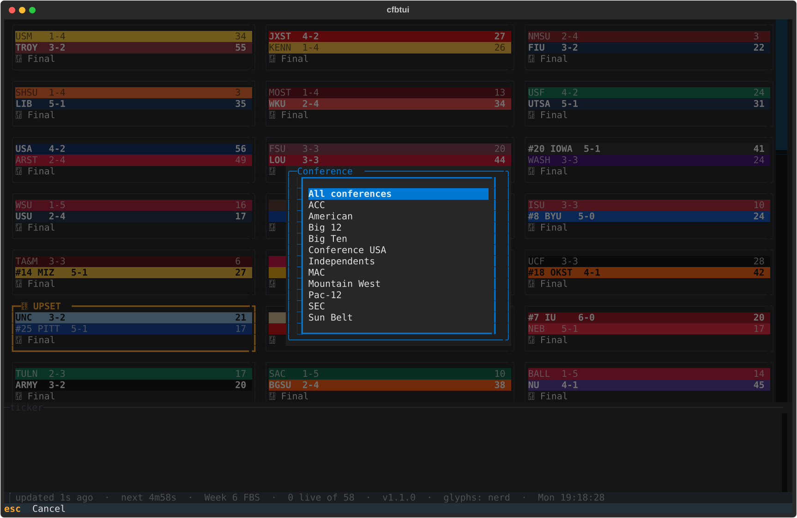

# cfbtui

A college football scoreboard that runs in your terminal. Every FBS and FCS game for the week, with live
scores, clock, down and distance, rankings and a ticker of what just happened.


## Get it

1. Download `cfbtui.exe` from the [latest release](https://github.com/WPTK/cfbtui/releases/latest).
2. Open Windows Terminal, go to the folder you saved it in, and run `.\cfbtui.exe`.

There is nothing to install. Windows may warn about an unrecognized app the first time; choose
"More info", then "Run anyway". The file isn't code-signed yet.

It needs a terminal that can show colors and Unicode. Windows Terminal works well. The old Command Prompt
window does not.

## What it does

- Shows every FBS and FCS game for the week, live ones first, then upcoming, then finished.
- Updates on its own: every 20 seconds while a game is on, every 5 minutes otherwise.
- Live cards show the clock, down and distance, and who has the ball. A card flashes when someone scores.
- Marks upsets: a ranked team that is losing, or lost, to a worse-ranked or unranked team gets a yellow border and an UPSET label.
- A ticker lists scores, kickoffs and upsets as they happen.
- Game detail with every scoring play and win probability.
- AP and Coaches polls, switching to the CFP ranking once the committee releases it.
- Starred favorites pinned at the top, saved between runs.
- Filters for Top 25, live games and favorites, and a conference picker.
- Cards or a one-line-per-game list.
- Browses past and future weeks, plus Bowls and the Playoff.
- Copies a game, or the whole board, ready to paste into Discord.
- Tells you when a newer version is out.

## Keys

| Key | What it does |
|---|---|
| arrow keys | Move between games |
| `Enter` | Open the game: every scoring play and win probability |
| `R` | Rankings |
| `[` `]` | Previous / next week. After week 15 come **Bowls** and the **Playoff** |
| `t` | Back to this week |
| `f` | Switch between FBS and FCS |
| `l` | Filter: all games, Top 25, live only, favorites |
| `o` | Pick a conference |
| `v` | Switch between cards and a one-line-per-game list |
| `1` `2` | Star the away / home team of the selected game |
| `c` | Copy the selected game for Discord |
| `C` | Copy every game on screen for Discord |
| `r` | Refresh now |
| `g` | Change the icon style |
| `Esc` | Close a screen |
| `q` | Quit |






**Rankings.** You see the AP and Coaches polls until the College Football Playoff committee releases its
first ranking. From then on you see only the CFP ranking, through the end of the season. The FCS board shows
the FCS Coaches poll.

**Favorites.** Star a team with `1` or `2` and its games move to a Favorites section at the top.

**Discord.** `c` copies one game as a line of text with the winner in bold. `C` copies the board as a
code block. Discord caps messages at 2,000 characters, so on a big Saturday `C` copies one part at a time:
press it again for the next part.


## Icons

Icons come in four styles: `nerd` (the default), `unicode`, `emoji` and `ascii`. `nerd` needs a
[Nerd Font](https://www.nerdfonts.com/) set as your terminal's font. If you see empty boxes where icons
should be, press `g` to cycle styles or start with `--glyphs unicode`.


## Starting options

```
cfbtui.exe --week 9              start on week 9 (also: --week bowls, --week playoff)
cfbtui.exe --group fcs           start on the FCS board
cfbtui.exe --glyphs unicode      icon style: ascii, unicode, emoji, nerd
cfbtui.exe --layout list         one line per game
cfbtui.exe --no-update-check     don't look for a newer version
cfbtui.exe --no-config           ignore and never touch the settings file
cfbtui.exe --version
```

These apply to that run only.

## Settings file

cfbtui creates `%LOCALAPPDATA%\cfbtui\config.toml` the first time you star a team. You can edit it in
Notepad. Anything you leave out uses the default; a bad value is ignored with a warning.

```toml
[poll]
live = 20          # seconds between updates while a game is on
idle = 300         # seconds between updates otherwise

[view]
glyph_set = "nerd" # ascii, unicode, emoji, nerd
layout = "grid"    # grid or list
week = 7           # 1-15, 16 for Bowls, 17 for the Playoff; leave out for the current week
group = "fbs"      # fbs or fcs

[favorites]
team_ids = ["251"]
abbreviations = ["TEX"]   # you can also list teams by abbreviation

[updates]
check = true       # set to false to never check for a newer version
```

## Updates

When it starts, cfbtui asks GitHub whether a newer release exists and shows a notice if so. That is the only
thing it sends besides asking ESPN for scores, and it sends no personal information. Turn it off with
`--no-update-check` or `check = false` in the settings file.

## Where the scores come from

ESPN's public scoreboard service, which is unofficial and undocumented. It can change or disappear without
warning. cfbtui is an independent project, not affiliated with ESPN or the NCAA.

## For developers

Building from source, running the tests and cutting a release: [docs/development.md](docs/development.md).

## License

MIT. See [LICENSE](LICENSE).
